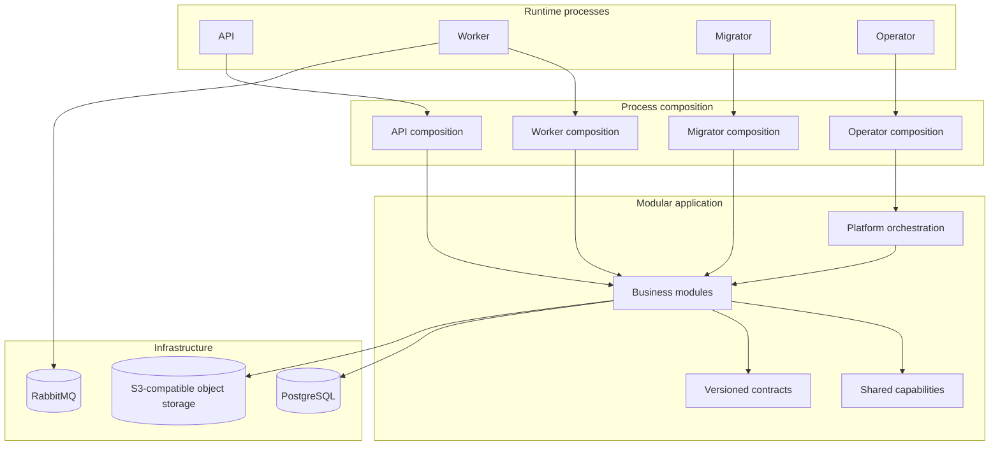

# Harpy

**A Go-based modular backend platform for multi-tenant and on-premise applications.**

Harpy is a production-oriented backend foundation built around explicit module ownership, tenant isolation, contract-driven interfaces, and durable background processing. It brings core application capabilities and the infrastructure required to operate them into one cohesive Go codebase—without turning every capability into a separately deployed service.

The name **Harpy** is inspired by the harpy eagle. The reference is symbolic: a backend should be strong, capable, and dependable under demanding workloads.

<p align="center">
  <a href="https://go.dev/"></a>
  <a href="https://www.postgresql.org/"></a>
  <a href="https://www.rabbitmq.com/"></a>
  <a href="https://www.docker.com/"></a>
  <a href="https://opentelemetry.io/"></a>
</p>

---

## Overview

Harpy is designed for applications that need more than an HTTP server and a database. It provides a structured backend foundation for identity, tenant lifecycle, authorization, commercial capabilities, content management, collaboration, analytics, notifications, and platform operations.

It supports two deployment models:

| Deployment | Intended use | Tenant model |
| --- | --- | --- |
| **Single-tenant** | Dedicated customer environments and on-premise installations | One customer environment |
| **Multi-tenant** | Shared SaaS deployments | Multiple isolated tenants |

Harpy is a **backend repository**. It exposes HTTP APIs and runs background workloads; it does not contain a built-in frontend application.

## Capabilities

The codebase is organized around business modules with explicit ownership boundaries.

| Area | Capabilities |
| --- | --- |
| **Identity & Access (IAM)** | Identity, authentication, credentials, sessions, organizations, RBAC, permissions, invitations, profiles, and service principals |
| **Tenancy** | Tenant lifecycle, provisioning, onboarding, deployment policy, tenant settings, and activation |
| **Billing** | Offerings, pricing, subscriptions, invoices, entitlements, usage, retention, and license authority |
| **Catalog** | Signed packages, dependency resolution, release publication, component lifecycle, and menu management |
| **Work Management** | Boards, columns, memberships, tasks, labels, checklists, comments, calendars, and recurrence |
| **Documents** | Folders, items, versions, uploads, downloads, links, archives, recovery, encryption, and scanning integrations |
| **Notifications** | Messages, preferences, templates, provider configuration, and delivery |
| **Analytics** | Saved queries, query execution, dashboards, exports, publication, and access control |
| **Audit & Usage** | Owner-operation audit trails, field-change evidence, usage observations, and reporting |
| **Platform Authority & Operations** | Authority evidence, diagnostics, health, alerts, traces, recovery sets, and restore operations |
| **Support** | Platform and tenant support contacts and bug reports |
| **System Resource Layout** | Revisioned system resource layouts and presentation metadata |

These are implemented capabilities, not a promise that every possible workflow or product surface is included. For the exact module and package inventory, see the [module package map](docs/architecture/15-modul-paket-haritasi.md).

## Architecture

Harpy uses a **modular monolith** architecture.

Modules are business ownership boundaries—not independent deployables. Each module owns its domain rules, application use cases, and persistence adapters. API, worker, migrator, and operator processes compose the modules they need through dedicated composition roots.

This keeps in-process use cases simple and avoids unnecessary network boundaries while preserving explicit ownership and dependency rules.

### Runtime processes

| Process | Entry point | Responsibility |
| --- | --- | --- |
| **API** | `core/cmd/api` | Public HTTP API, route assembly, request admission, and runtime readiness |
| **Worker** | `core/cmd/worker` | Background jobs, event consumers, retries, and asynchronous effects |
| **Migrator** | `core/cmd/migrator` | Database migration execution and schema lifecycle |
| **Operator** | `core/cmd/operator` | Installation and controlled platform operations |
| **Setup CLI** | `cmd/setup` | Deployment profile configuration and local secret preparation |

The process entry points stay deliberately thin. Dependency construction and runtime lifecycle belong to `core/internal/composition/`.

### Architectural boundaries

- **Domain** contains business types, invariants, and state transitions. It does not depend on HTTP, database drivers, or infrastructure SDKs.
- **Application** coordinates use cases, authorization, transactions, and side effects.
- **Ports and adapters** isolate persistence, HTTP, events, and external providers.
- **Module APIs** are the supported synchronous cross-module interface. A module must not reach into another module's private packages or tables.
- **Capabilities** provide reusable technical contracts such as REST Query, object storage, artifact handling, credential delivery, and tenant activation.
- **Orchestration** coordinates multi-step operations across owners without taking ownership of their business data.
- **Composition roots** wire concrete modules and adapters for each process.



### Data ownership and tenant isolation

PostgreSQL is the canonical state store for business data, durable job state, idempotency receipts, and event publication intent.

Tenant data follows a **schema-per-tenant** model. Tenant scope is derived from the authenticated actor and canonical server-side tenant identity; it is not trusted from an arbitrary request header. Platform/global data uses separately defined ownership and scope.

Modules do not query or mutate another module's tables directly. Cross-module work uses owner APIs, explicit coordination, and transaction boundaries.

### Asynchronous processing

Harpy combines PostgreSQL-backed durable work with RabbitMQ as an integration transport.

- The **outbox** records event publication intent transactionally with business state.
- **RabbitMQ** transports events between asynchronous producers and consumers; it is not the source of truth.
- **Database-backed jobs** persist scheduled/background work, attempts, leases, and execution state.
- Consumers and external effects are designed for retries and at-least-once delivery, with idempotency and explicit failure handling.

### Contracts and security

HTTP, event, runtime, authority, storage, and asynchronous processing contracts are versioned under `contracts/`. Request schemas, event versions, producer/consumer policies, and generated API descriptions are treated as explicit interfaces.

The security model is designed to fail closed: missing actor identity, tenant scope, permission, authority evidence, or invalid contract data must not silently become an allowed operation. Authentication and authorization are separate concerns, and resource-level policies remain with their owning modules.

## Technology

| Concern | Implementation |
| --- | --- |
| Language | Go 1.26 |
| Relational database | PostgreSQL 18, accessed through pgx |
| Message broker | RabbitMQ 4 |
| Object storage | S3-compatible API; RustFS in the standard deployment profile |
| API contracts | Versioned HTTP contracts, JSON Schema, and OpenAPI |
| Async contracts | Versioned event, producer/consumer, and job manifests |
| Observability | OpenTelemetry traces and metrics with OTLP exporters |
| Runtime | Docker Compose and Task |
| Testing | Go unit/application tests, adapter and integration tests, security tests, and architecture checks |

The dependency source of truth is [`go.mod`](go.mod). Deployment service definitions are maintained in [`deploy/third-party.yml`](deploy/third-party.yml).

## Getting started

### Requirements

For backend development:

- Go 1.26 toolchain
- Docker Engine or Docker Desktop with Compose v2
- [Task](https://taskfile.dev/)
- Internet access for the initial dependency and image build

The full local stack also starts supporting services and the sibling frontend project. See [Local development](ops/local/README.md) for its additional requirements and operational details.

### Run the complete local development stack

The recommended path for developing against the full local environment is:

```bash
git clone https://github.com/Onurlulardan/harpy.git
cd harpy

task dev
```

`task dev` delegates to the repository's local stack workflow. It prepares local-only secrets and certificates, builds the pinned images, starts infrastructure, bootstraps the environment, applies migrations, starts runtime services, and verifies readiness.

To stop the stack while preserving named volumes:

```bash
task stop
```

To inspect logs:

```bash
task local:logs
task local:logs:api
task local:logs:worker
```

> **Data warning:** `task local:destroy` is a destructive operation. It removes local database, broker, object-storage, and related state. Use it only when you intend to reset the local environment.

### Prepare a standard deployment profile

For a standalone single-tenant or multi-tenant deployment, use the setup CLI:

```bash
go run ./cmd/setup
```

The setup command validates the selected profile, prepares local configuration and secret material, writes the corresponding deployment environment file, and prints the next commands.

You can select a profile non-interactively:

```bash
go run ./cmd/setup --defaults --profile single-tenant
# or
go run ./cmd/setup --defaults --profile multi-tenant
```

The generated profile is written under `deploy/<profile>/`. The setup command does not start Docker or silently run the entire application lifecycle; follow the commands it prints for Compose, migration, initialization, API, and worker startup.

See [Deployment and operations](docs/architecture/09-deployment-ve-operasyon.md) for deployment profiles and [Local stack guide](ops/local/README.md) for the complete local workflow.

## Development

### Repository layout

```text
cmd/
  setup/                       Deployment setup CLI

core/
  cmd/
    api/                       HTTP API entry point
    worker/                    Background worker entry point
    migrator/                  Database migration entry point
    operator/                  Platform operator entry point
  internal/
    composition/               Per-process runtime composition
    modules/                   Business modules and their owners
    capabilities/              Shared technical capabilities
    orchestration/             Multi-step platform workflows
    platform/                  Infrastructure and runtime primitives

contracts/                     Versioned HTTP, event, runtime, and storage contracts
compat/                        Explicit compatibility adapters
deploy/                        Single-tenant, multi-tenant, and third-party Compose definitions
ops/                           Local development and operational workflows
tools/                         File, architecture, contract, and engineering tools
skills/                        Repository-specific engineering procedures
docs/
  architecture/                Architecture and module documentation
```

### Useful commands

| Command | Purpose |
| --- | --- |
| `go test ./...` | Run the Go test suite |
| `go run ./tools/fileguard` | Check file organization and generated-file provenance |
| `go run ./tools/archguard` | Check package dependencies and architectural boundaries |
| `task check` | Run the repository's file and architecture guards |
| `task dev` | Start the complete local development stack |
| `task stop` | Stop the local stack and preserve data |

### Engineering conventions

Harpy's repository-level development protocol is documented in [`AGENTS.md`](AGENTS.md). Before changing code, follow the skill routing in [`skills/INDEX.md`](skills/INDEX.md), read the relevant skill, and inspect the affected architecture and contract documents.

The main rules are:

1. Keep business state and policy inside the owning module.
2. Use another module's public API for synchronous cross-module calls.
3. Do not access another module's tables or private packages.
4. Keep handlers focused on transport; application use cases own business orchestration.
5. Derive tenant identity from verified actor context and fail closed on missing scope.
6. Treat RabbitMQ as transport, not canonical state.
7. Keep HTTP, event, runtime, and authority contracts explicit and versioned.
8. Add tests for authorization, tenant isolation, retries, idempotency, and failure paths—not only successful requests.
9. Run the targeted tests and the relevant repository quality gates before considering a change complete.

## Documentation

The architecture documentation is the canonical human-readable guide to Harpy's current design. Start with the [architecture index](docs/architecture/README.md).

| Document | What it covers |
| --- | --- |
| [General overview](docs/architecture/01-genel-bakis.md) | Product scope, technology, repository map, and processes |
| [Architecture and module boundaries](docs/architecture/02-mimari-ve-modul-sinirlari.md) | Modular monolith, layers, dependencies, and ownership |
| [Runtime and composition](docs/architecture/03-runtime-ve-composition.md) | Setup, API, worker, migrator, operator, and lifecycle |
| [Platform foundations](docs/architecture/04-platform-temelleri.md) | Configuration, PostgreSQL, transactions, telemetry, and health |
| [HTTP API and contracts](docs/architecture/05-http-api-ve-kontratlar.md) | Routing, HTTP contracts, errors, and REST Query |
| [Data and tenant isolation](docs/architecture/06-veri-ve-tenant-izolasyonu.md) | Schema-per-tenant, scopes, data ownership, and transactions |
| [Events, jobs, and workers](docs/architecture/07-event-job-ve-worker.md) | Outbox, RabbitMQ, durable jobs, retries, leases, and workers |
| [Security model](docs/architecture/08-guvenlik-modeli.md) | Actors, IAM, RBAC, tokens, tenant security, and secrets |
| [Deployment and operations](docs/architecture/09-deployment-ve-operasyon.md) | Compose profiles, local stack, health, logs, and operations |
| [Testing and engineering standards](docs/architecture/10-test-ve-muhendislik-standartlari.md) | CI, testing strategy, fileguard, and archguard |
| [Developer guide](docs/architecture/11-gelistirici-rehberi.md) | Setup, commands, module changes, and troubleshooting |
| [Shared capabilities and orchestration](docs/architecture/12-paylasilan-capabilities.md) | REST Query, artifacts, tenant activation, and orchestration |
| [Contract catalog](docs/architecture/13-kontrat-katalogu.md) | HTTP, event, runtime, authority, and storage contracts |
| [Architecture decisions](docs/architecture/14-mimari-kararlar.md) | Trade-offs and architectural rationale |
| [Module package map](docs/architecture/15-modul-paket-haritasi.md) | Application and adapter package groups by module |

The architecture guide also contains focused documentation for [IAM](docs/architecture/modules/iam.md), [Tenancy](docs/architecture/modules/tenancy.md), [Billing](docs/architecture/modules/billing.md), [Catalog](docs/architecture/modules/catalog.md), [Work](docs/architecture/modules/work.md), [Documents](docs/architecture/modules/documents.md), [Notifications](docs/architecture/modules/notifications.md), [Analytics](docs/architecture/modules/analytics.md), and [other modules](docs/architecture/modules/diger-moduller.md).

## Project scope

Harpy's current scope is the backend foundation and the capabilities present in this repository. It is not presented as a generic low-code platform or as a collection of independently deployed microservices. Features such as a Forms Engine, Workflow Engine, AI module, or MCP server are not part of the documented current product scope.

## License

No license file is currently published in this repository. Until a license is added, the repository should not be assumed to grant permissions for reuse, modification, or redistribution.
