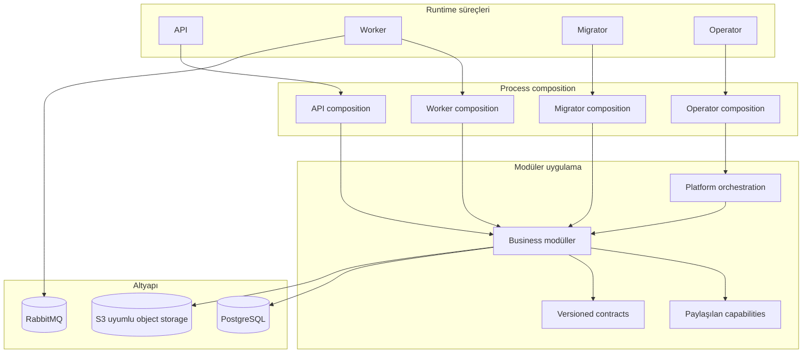

# Harpy

**Çok kiracılı (multi-tenant) ve kurum içi (on-premise) uygulamalar için Go tabanlı modüler backend platformu.**

Harpy; açık modül sahipliği, tenant izolasyonu, contract odaklı arayüzler ve kalıcı arka plan işleme üzerine kurulu bir backend platformudur. Identity ve erişim yönetiminden tenant yaşam döngüsüne, billing'den belge yönetimine ve platform operasyonlarına kadar farklı backend yeteneklerini tek bir Go codebase içinde bir araya getirir.

Harpy, her iş alanını ayrı bir microservice olarak dağıtmak yerine **modular monolith** yaklaşımını benimser. Modüller kendi domain ve veri sahipliğini korurken aynı uygulama kod tabanı içinde çalışır; API, worker, migrator ve operator ise farklı runtime sorumlulukları üstlenir.

**Harpy** ismi, güçlü ve dayanıklı bir backend vizyonunu temsil etmesi için harpy eagle'dan (harpi kartalı) esinlenerek seçildi.

<p align="center">
  <a href="https://go.dev/"></a>
  <a href="https://www.postgresql.org/"></a>
  <a href="https://www.rabbitmq.com/"></a>
  <a href="https://www.docker.com/"></a>
  <a href="https://opentelemetry.io/"></a>
</p>

---

## İçindekiler

- [Genel Bakış](#genel-bakış)
- [Yetenekler ve Modüller](#yetenekler-ve-modüller)
- [Mimari](#mimari)
- [Veri ve Tenant İzolasyonu](#veri-ve-tenant-izolasyonu)
- [Asenkron İşleme](#asenkron-işleme)
- [Güvenlik ve Sözleşmeler](#güvenlik-ve-sözleşmeler)
- [Teknoloji Yığını](#teknoloji-yığını)
- [Deployment Modelleri](#deployment-modelleri)
- [Hızlı Başlangıç](#hızlı-başlangıç)
- [Geliştirme](#geliştirme)
- [Dokümantasyon](#dokümantasyon)
- [Proje Kapsamı ve Lisans](#proje-kapsamı-ve-lisans)

## Genel Bakış

Harpy, yalnızca HTTP server ve database ihtiyacının ötesinde; identity, tenant yaşam döngüsü, authorization, ticari yetenekler, içerik yönetimi, iş birliği, analytics, notifications ve platform operasyonları gerektiren uygulamalar için geliştirilmiştir.

Temel yaklaşım, uygulamanın business kurallarını ve verisini açık sahiplik sınırları altında tutarken ortak altyapı yeteneklerini tekrar kullanılabilir hale getirmektir. Bir modül başka modülün veritabanı tablolarına veya private package'lerine doğrudan erişmez. Modüller arası entegrasyonlar public API'ler, açık contract'lar ve gerektiğinde asenkron event akışları üzerinden kurulur.

Harpy iki temel deployment modelini destekler:

| Deployment modeli | Kullanım | Tenant yapısı |
| --- | --- | --- |
| **Single-tenant** | Müşteriye özel ortamlar ve on-premise kurulumlar | Tek müşteri ortamı |
| **Multi-tenant** | Paylaşımlı SaaS deployment'ları | Aynı platformda birbirinden izole birden fazla tenant |

Harpy bir **backend repository**'sidir. HTTP API sunar ve arka plan işlerini yürütür; bu repository içinde yerleşik bir frontend uygulaması bulunmaz.

## Yetenekler ve Modüller

Harpy'nin business yetenekleri, veri ve iş kuralı sahipliği belirlenmiş modüller halinde düzenlenmiştir.

| Modül / Alan | Kapsam |
| --- | --- |
| **IAM — Identity & Access Management** | Identity, authentication, credentials, sessions, organizations, RBAC, permissions, invitations, profiles, service principals ve erişim yönetimi |
| **Tenancy** | Tenant yaşam döngüsü, provisioning, onboarding, deployment policy, tenant settings ve tenant activation |
| **Billing** | Offerings, pricing, subscriptions, invoices, entitlements, usage, retention ve license authority |
| **Catalog** | İmzalı paketler, dependency resolution, release publication, component lifecycle ve menu yönetimi |
| **Work Management** | Boards, columns, memberships, tasks, labels, checklists, comments, calendars ve recurrence |
| **Documents** | Folders, items, versions, uploads, downloads, links, archives, recovery, encryption ve scanning entegrasyonları |
| **Notifications** | Messages, preferences, templates, provider configuration ve delivery süreçleri |
| **Analytics** | Saved queries, query execution, dashboards, exports, publication ve access control |
| **Audit** | Owner operation audit kayıtları ve field-change kanıtları |
| **Usage** | Usage observations, feature usage kayıtları ve raporlama altyapısı |
| **Platform Authority** | Authority kanıtları, imzalı öneriler, acknowledgement ve checkpoint süreçleri |
| **Platform Operations** | Diagnostics, health, alerts, traces, recovery sets, restore planları ve restore operasyonları |
| **Support** | Platform ve tenant destek kayıtları, support contact ve bug reports |
| **System Resource Layout** | Sürümlenen system resource layout'ları ve presentation metadata |

Bu tablo modüllerin ana sorumluluk alanlarını özetler. Bir modülün tüm use-case ve adapter ayrıntıları için [modül dokümantasyonuna](docs/architecture/README.md#modül-belgeleri) ve kaynak koduna bakılmalıdır.

## Mimari

Harpy, **modular monolith** mimarisini kullanır. Modüller business ownership sınırlarıdır; bağımsız deployable servisler değildir. Her modül kendi domain kurallarının, application use-case'lerinin ve persistence adapter'larının sahibidir.

API, worker, migrator ve operator süreçleri ihtiyaç duydukları modülleri ayrı composition root'ları üzerinden bir araya getirir. Böylece aynı process içindeki use-case çağrıları gereksiz HTTP veya message broker hop'larına dönüşmez. Ayrı process kullanımı ise HTTP trafiği, background workload, schema lifecycle ve yönetim operasyonlarının çalışma sınırlarını birbirinden ayırır.

### Runtime süreçleri

| Süreç | Giriş noktası | Sorumluluk |
| --- | --- | --- |
| **API** | `core/cmd/api` | Public HTTP API, route assembly, request admission ve runtime readiness |
| **Worker** | `core/cmd/worker` | Database-backed jobs, event consumers, retry ve asenkron yan etkiler |
| **Migrator** | `core/cmd/migrator` | Database migration yürütümü ve schema lifecycle |
| **Operator** | `core/cmd/operator` | Kurulum ve kontrollü platform operasyonları |
| **Setup CLI** | `cmd/setup` | Deployment profil yapılandırması ve yerel secret hazırlığı |

Process giriş noktaları ince tutulur. Dependency wiring, runtime lifecycle ve somut adapter seçimi `core/internal/composition/` altında yapılır.

### Katmanlar ve bağımlılık yönü

Harpy modüllerinde görülen ana mimari katmanlar şunlardır. Her modül yalnızca ihtiyaç duyduğu paketleri taşır; kullanılmayan katmanlar sırf şablona uymak için oluşturulmaz.

| Katman | Sorumluluk |
| --- | --- |
| **Domain** | Business type'ları, invariant'lar, validation ve state transition kuralları |
| **Application** | Use-case'ler, authorization çağrıları, transaction sınırları ve side effect koordinasyonu |
| **Ports** | Modülün dış dünyadan beklediği dar arayüzler |
| **Adapters** | HTTP, PostgreSQL, event ve dış provider entegrasyonlarının somut implementasyonları |
| **Module API** | Diğer modüllerin senkron olarak kullanabileceği public command/query contract'ları |
| **Composition** | Process başına modül ve adapter wiring'i |

Temel bağımlılık yönü:

```text
HTTP adapter ─────┐
PostgreSQL adapter ├──> application ───> domain
Event adapter ────┘

composition ─────────> module constructors
module A ────────────> module B/api
```

Bir modül başka modülün `domain`, `application`, `ports`, `adapters` veya persistence paketini import etmez. Başka modülün tablolarına doğrudan SQL/JOIN veya foreign-key bağımlılığı eklemez. Senkron iletişim owner modülün public API'si üzerinden; çok adımlı koordinasyon ise orchestration sınırında gerçekleştirilir.

### Mimari görünüm



### Platform ve paylaşılan capabilities

`core/internal/platform/` genel teknik runtime primitive'lerini barındırır. Config, clock/ID, PostgreSQL bağlantıları, transaction, telemetry, health, HTTP transport, lifecycle ve object/blob transport bu sınırın başlıca sorumluluklarıdır. Business policy yalnızca teknik olarak ortak göründüğü için platform katmanına taşınmaz; ilgili business modülünün sahibi olarak kalır.

`core/internal/capabilities/` birden fazla modülün kullanabildiği, daha üst seviyeli teknik yetenekleri sağlar. Öne çıkan örnekler:

| Capability | Sorumluluk |
| --- | --- |
| **REST Query** | Typed query modeli, field catalog, validation, authorization, planning ve execution |
| **Artifact Object** | S3-compatible object read/write/delete, digest ve reconciliation arayüzleri |
| **Artifact Spool** | Geçici artifact üretimi için bounded workspace, lease ve cleanup |
| **Catalog Component / Projection** | Catalog component owner contract'ları ve consumer projection modelleri |
| **Credential Delivery** | Credential artifact ve kontrollü delivery contract'ları |
| **License Bootstrap / Restored License** | License authority bootstrap ve restore sonrası binding yetenekleri |
| **Tenant Activation** | Doğrulanmış activation grant ve activation scope |
| **Tabular Mapping / Transfer** | Tabular data mapping, import/export ve transfer contract'ları |

`core/internal/orchestration/` ise birden fazla owner veya capability arasında yürütülen çok adımlı platform operasyonlarını koordine eder. Orchestration yeni bir business data owner değildir; ilgili owner API'lerini çağırır ve operasyon sırasını yönetir.

## Veri ve Tenant İzolasyonu

PostgreSQL; business data, kalıcı job state, idempotency receipt ve event publication intent için canonical state kaynağıdır.

Tenant verileri **schema-per-tenant** modeliyle ayrılır. Her tenant kendi PostgreSQL schema sınırında çalışır. Tenant scope, doğrulanmış actor context ve sunucu tarafında belirlenen canonical tenant identity üzerinden oluşturulur; request header'ından güvenilir kabul edilmez. Platform/global veriler ayrı sahiplik ve scope kurallarıyla yönetilir.

Bu modelin mimari sonuçları:

- Tenant kimliği her use-case için doğrulanmış context üzerinden taşınır.
- Tenant schema adı, güvenilir tenant identity üzerinden server-side belirlenir.
- PostgreSQL connection/session state tenant sınırları gözetilerek yönetilir.
- Bir modül başka modülün tablolarını doğrudan sorgulamaz veya değiştirmez.
- Cross-module işlemler owner API, orchestration ve tanımlı Unit of Work/transaction sınırları üzerinden yürütülür.
- Eksik veya doğrulanmamış tenant scope, başarılı erişim varsayılmaz; işlem fail-closed davranır.

Şema sahipliği, tenant scope ve transaction akışının ayrıntıları için [Veri ve tenant izolasyonu](docs/architecture/06-veri-ve-tenant-izolasyonu.md) belgesine bakın.

## Asenkron İşleme

Harpy, PostgreSQL üzerinde kalıcı iş yönetimini RabbitMQ'yu integration transport olarak kullanmakla birleştirir. Broker, business state'in veya job lifecycle'ın tek otoritesi değildir.

### Outbox ve event akışı

- **Outbox**, event yayınlama niyetini business state değişikliğiyle aynı database transaction içinde kaydeder.
- Event'ler versioned envelope ve payload contract'ları ile taşınır.
- Producer ve consumer ilişkileri manifest ve policy'lerle sınırlandırılır.
- RabbitMQ publish/consume için transport katmanıdır; event'in business state kaydı PostgreSQL tarafında tutulur.
- Consumer'lar duplicate delivery, retry ve sequence durumlarını dikkate alır.

### Database-backed jobs ve worker

- Job kind ve payload şekilleri sürümlenen contract'larla tanımlanır.
- Job state, attempt, lease owner/expiry ve execution sonucu kalıcı olarak izlenir.
- Worker startup sırasında processor registration ve ilgili async contract uyumluluğu doğrulanır.
- Geçici ve kalıcı hatalar ayrıştırılır; retry ve dead-letter davranışı açıkça yönetilir.
- Dış sistem etkilerinde idempotency ve belirsiz sonuçların uzlaştırılması önemlidir.

Bu yaklaşım, RabbitMQ veya harici provider geçici olarak erişilemediğinde iş kaydının kaybolmasını engellemeyi ve tekrar çalıştırılabilir operasyonlar oluşturmayı hedefler. Teslimat semantiği at-least-once koşullarına göre ele alınır; consumer ve side effect implementasyonları buna uygun tasarlanır.

Ayrıntılar: [Event, job ve worker](docs/architecture/07-event-job-ve-worker.md).

## Güvenlik ve Sözleşmeler

Harpy'de authentication, authorization, tenant scope ve resource policy farklı sorumluluklardır. IAM; identity, credentials, sessions, organizations, RBAC ve permission altyapısının owner'ıdır. Business modülleri kendi resource ve operation seviyesindeki authorization kararlarını tanımlı sınırlar içinde uygular.

Güvenlik yaklaşımı **fail-closed** davranır: doğrulanmış actor, tenant scope, permission veya authority kanıtı yoksa işlem varsayılan olarak kabul edilmez. Eksik veya bilinmeyen veriler sessizce izinli hale getirilmez.

### Sürümlenen contract'lar

HTTP, event, runtime, authority, storage ve asynchronous processing sözleşmeleri `contracts/` altında sürümlenir.

| Contract alanı | İçerik |
| --- | --- |
| `contracts/http/` | HTTP path, request/response schema ve OpenAPI tanımları |
| `contracts/events/` | Event envelope, payload, version ve consumer/producer policy'leri |
| `contracts/runtime/` | Runtime config, health, error ve binary contract'ları |
| `contracts/authority/` | Owner, operation, capability ve authority policy tanımları |
| `contracts/storage/` | Database schema/table ownership ve grant sınırları |
| `contracts/jobs/` | Job kind ve payload contract'ları |
| `contracts/asyncmanifest/` | Async producer/consumer catalog ve policy'leri |

Contract değişikliği yalnızca Go handler veya struct değişikliği değildir. Request schema, response schema, error modeli, authorization, OpenAPI aggregate ve contract testleri birlikte değerlendirilir. Bilinmeyen field, operator, enum veya node sessizce kabul edilmez.

### REST Query

Dynamic query yürütümü REST Query `QuerySpec` üzerinden gerçekleştirilir. Consumer modül kendi resource ve field ownership bilgisini sağlar; ortak capability query'yi validate eder, authorization profile uygular, filter/sort/include/aggregate alanlarını normalize eder ve kontrollü execution plan oluşturur.

Raw SQL, belirsiz field veya bilinmeyen operator doğrudan API girdisi olarak yürütülmez. Query budget ve parametrized execution sınırları korunur.

Ayrıntılar: [HTTP API ve contracts](docs/architecture/05-http-api-ve-kontratlar.md) ve [Paylaşılan capabilities](docs/architecture/12-paylasilan-capabilities.md).

## Teknoloji Yığını

| Katman | Teknoloji |
| --- | --- |
| Dil ve toolchain | Go 1.26; repository toolchain 1.26.5 |
| Relational database | PostgreSQL 18, pgx v5 |
| Message broker | RabbitMQ 4, `amqp091-go` |
| Object storage API | S3-compatible API, AWS SDK for Go v2 |
| Standart deployment object storage | RustFS |
| API contract | Versioned HTTP contracts, JSON Schema ve OpenAPI |
| Async contract | Versioned event, producer/consumer ve job manifestleri |
| Observability | OpenTelemetry traces ve metrics, OTLP exporters |
| Runtime ve orchestration | Docker Compose ve Task |
| Test altyapısı | Go test, PostgreSQL integration testleri ve Testcontainers |

Dependency listesinin kaynağı [`go.mod`](go.mod), standart üçüncü parti deployment servislerinin tanımı [`deploy/third-party.yml`](deploy/third-party.yml) dosyasıdır.

Standart deployment tanımında PostgreSQL 18, RabbitMQ 4 ve RustFS bulunur. Local development stack ise ayrıca kendi operasyonel gereksinimlerine göre PostgreSQL, RabbitMQ, S3 katmanı, KMS, SMTP ve malware scanning gibi destek servislerini compose parçalarıyla yönetir. Bu iki deployment tanımı aynı kapsam olarak değerlendirilmemelidir.

## Deployment Modelleri

Harpy iki standart deployment profili sağlar:

| Profil | Compose dosyası | Tenant modu | Hedef |
| --- | --- | --- | --- |
| **Single-tenant** | `deploy/single-tenant/compose.yml` | `single` | Müşteriye özel veya on-premise kurulum |
| **Multi-tenant** | `deploy/multi-tenant/compose.yml` | `multi` | Çok tenant'lı SaaS ortamı |

Her iki profil ortak üçüncü parti servis tanımlarını `deploy/third-party.yml` üzerinden kullanır. Secret dosyaları profil dizini altında tutulur ve source control'e eklenmez. Compose tenant mode ile runtime deployment mode ayarları birbiriyle uyumlu olmalıdır.

### Setup CLI

`cmd/setup`, deployment profilini ve yerel çalışma ayarlarını hazırlayan CLI'dır. Etkileşimli modda profil ve kurulum bilgilerini sorar; `--defaults` ile varsayılan cevaplar kullanılabilir. Secret rotation ve management listen adresi gibi kontrollü seçenekleri de destekler.

Setup CLI'nin temel sorumlulukları:

1. Repository kökünü bulmak ve argümanları doğrulamak.
2. Single-tenant veya multi-tenant profilini belirlemek.
3. Önceki profile ait ayarları ve secret materyalini okumak.
4. Gerekli secret ve admin credential hazırlığını yapmak.
5. Cevapları doğrulamak.
6. `deploy/<profile>/` altına environment ve secret dosyalarını yazmak.
7. Sonraki Compose, migration, initialization, API ve worker komutlarını göstermek.

Setup CLI Docker başlatmaz ve uygulamanın tüm yaşam döngüsünü tek başına yürütmez. Standart deployment adımlarını CLI çıktısına göre tamamlamak gerekir.

## Hızlı Başlangıç

### Gereksinimler

Backend geliştirme ve local stack için:

- Go 1.26 toolchain (repository toolchain: 1.26.5).
- Docker Desktop veya Docker Engine ve Docker Compose v2.
- [Task](https://taskfile.dev/) (`task` komutu).
- İlk dependency ve image build işlemleri için internet erişimi.
- Local stack ClamAV imza yüklemesi için Docker'a en az 4 GB RAM ayrılması.

Local stack kardeş `frontend-v3` projesini de çalıştıracak şekilde yapılandırılmıştır. Frontend de kullanılacaksa Node.js 22+, Yarn 1 ve kardeş frontend repository'sinin kurulu olması gerekir. Yalnız backend geliştirme için frontend toolchain'i gerekli değildir.

### Tam local development stack'i başlatma

Repository'yi klonlayıp kök dizinde çalıştırın:

```bash
git clone https://github.com/Onurlulardan/harpy.git
cd harpy
task dev
```

`task dev`, `task local:up` akışının kısa yoludur. Local workflow genel olarak şu adımları yürütür:

1. Makineye özel secret ve sertifikaları hazırlar.
2. Pinned image ve build girdilerini kullanarak gerekli image'ları oluşturur.
3. Servislere ait secret volume'larını hazırlar.
4. PostgreSQL, RabbitMQ ve diğer altyapı servislerini başlatır ve health kontrollerini yapar.
5. Local cluster bootstrap ve release kanıtı adımlarını yürütür.
6. Migration ve runtime grant işlemlerini uygular.
7. Gerekli installation/license ve tenant executor adımlarını tamamlar.
8. API, worker ve schema executor servislerini başlatır.
9. Runtime readiness kontrollerini yürütür.
10. Local workflow yapılandırmasına bağlı olarak sibling frontend development server'ını başlatır.

Normal durdurma işlemi named volume verilerini korur:

```bash
task stop
```

Logları izlemek için:

```bash
task local:logs
task local:logs:api
task local:logs:worker
task local:logs:infra
```

> **Veri uyarısı:** `task local:destroy` yıkıcı bir işlemdir. Local database, broker, object storage ve ilişkili state/volume'larını siler. Yalnızca geliştirme ortamını tamamen sıfırlamak istediğinizde kullanın.

### Local stack adresleri

Varsayılan local endpoint ve portlar:

| Yüzey | Adres |
| --- | --- |
| Frontend v3 | `http://localhost:5173` |
| Core API | `http://localhost:8000` |
| API management | `http://localhost:9001` |
| Worker management | `http://localhost:9002` |
| Schema executor management | `http://localhost:9003` |
| PostgreSQL | `localhost:55432` |
| RabbitMQ AMQP | `localhost:5673` |
| RabbitMQ management UI | `http://localhost:15673` |
| S3 owner proxy | `http://localhost:19000` |
| Mailpit SMTP | `localhost:1026` |
| Mailpit UI | `http://localhost:8026` |

Portlar `.env.local` içindeki `LOCAL_*_PORT` ayarlarıyla değiştirilebilir. Güncel ve ayrıntılı operasyon adımları için [ops/local/README.md](ops/local/README.md) esas alınmalıdır.

### Standart single-tenant veya multi-tenant profili hazırlama

Tam local developer stack yerine standart deployment profilini hazırlamak için:

```bash
go run ./cmd/setup
```

Etkileşimsiz örnek:

```bash
go run ./cmd/setup --defaults --profile single-tenant
# veya
go run ./cmd/setup --defaults --profile multi-tenant
```

Setup, `deploy/<profile>/` altında profile ait `.env` ve secret dosyalarını hazırlar; devamında çalıştırılması gereken Compose, migrator, operator, API ve worker komutlarını gösterir. Setup'ın ekrana bastığı sıra takip edilmelidir. Local `task dev` akışı ile standart deployment profilini hazırlama akışı farklı amaçlara hizmet eder.

## Geliştirme

### Repository yapısı

```text
cmd/
  setup/                       Deployment setup CLI

core/
  cmd/
    api/                       HTTP API giriş noktası
    worker/                    Background worker giriş noktası
    migrator/                  Database migration giriş noktası
    operator/                  Platform operator giriş noktası
  internal/
    composition/               Process bazlı runtime composition
    modules/                   Business modülleri ve sahiplik alanları
    capabilities/              Paylaşılan teknik yetenekler
    orchestration/             Çok adımlı platform iş akışları
    platform/                  Infrastructure ve runtime primitive'leri

contracts/                     Sürümlenen HTTP, event, runtime ve storage contracts
compat/                        Sınırlandırılmış uyumluluk adapter'ları
deploy/                        Single-tenant, multi-tenant ve ortak Compose tanımları
ops/                           Local geliştirme ve operasyon iş akışları
tools/                         Guard, contract ve mühendislik araçları
skills/                        Repository mühendislik prosedürleri
docs/
  architecture/                Mimari ve modül dokümantasyonu
```

### Önemli kaynak kod alanları

| İhtiyaç | Dizin |
| --- | --- |
| API giriş ve route wiring | `core/cmd/api/`, `core/internal/composition/api/` |
| Worker ve job wiring | `core/cmd/worker/`, `core/internal/composition/worker/` |
| Migrator | `core/cmd/migrator/`, `core/internal/composition/migrator/` |
| Operator | `core/cmd/operator/`, `core/internal/composition/operator/` |
| Business modülleri | `core/internal/modules/` |
| Platform primitive'leri | `core/internal/platform/` |
| Paylaşılan capabilities | `core/internal/capabilities/` |
| Orchestration | `core/internal/orchestration/` |
| HTTP, event ve runtime sözleşmeleri | `contracts/` |
| Deployment profilleri | `deploy/` |
| Local stack ve Task workflow'ları | `ops/local/`, `.taskfiles/`, `Taskfile.yml` |
| Test ve guard araçları | `tools/` |

### Kullanışlı komutlar

| Komut | Açıklama |
| --- | --- |
| `go test ./...` | Go test paketini çalıştırır |
| `go run ./tools/fileguard` | Dosya organizasyonu ve generated file provenance kurallarını denetler |
| `go run ./tools/archguard` | Package dependency ve mimari sınırları denetler |
| `task check` | Fileguard ve archguard kontrollerini çalıştırır |
| `task dev` | Tam local development stack'i başlatır |
| `task stop` | Local stack'i verileri koruyarak durdurur |
| `task local:status` | Backend container ve frontend sağlık durumunu gösterir |
| `task local:logs` | API, worker ve schema executor loglarını izler |
| `task local:check` | Local config, test ve mimari guard kontrollerini çalıştırır |

### Mühendislik kuralları

Repository çalışma protokolü [`AGENTS.md`](AGENTS.md) dosyasındadır. Kod değişikliğinden önce [`skills/INDEX.md`](skills/INDEX.md) üzerinden iş ile ilgili skill'ler belirlenmeli ve eksiksiz okunmalıdır. Etkilenen modülün mimari dokümanı, source kodu, testleri ve contract dosyaları birlikte incelenmelidir.

Temel mimari kurallar:

1. Business state ve policy ilgili owner modülde kalır.
2. Senkron modüller arası iletişimde hedef modülün public API'si kullanılır.
3. Başka bir modülün tablolarına, domain veya adapter paketlerine doğrudan erişilmez.
4. Handler transport sorumluluğunu taşır; business orchestration application use-case'lerinde bulunur.
5. Repository authorization kararı vermez.
6. Transaction sınırını application command belirler; HTTP middleware belirlemez.
7. Tenant identity doğrulanmış actor context'ten türetilir; request header tenant kimliğinin kaynağı değildir.
8. Aynı process içindeki modüller HTTP veya RabbitMQ üzerinden haberleşmez.
9. RabbitMQ state kaynağı değil, integration transport katmanıdır.
10. HTTP, event, runtime, authority ve storage contract'ları açık ve sürümlü tutulur.
11. Bilinmeyen field, operator veya node sessizce kabul edilmez.
12. Authorization, tenant isolation, retry, idempotency ve hata senaryoları test edilir.
13. Generated dosyalar elle değiştirilmez; provenance header'ları korunur.

### Kalite kapıları ve CI

CI workflow'u `.github/workflows/ci.yml` altında tanımlıdır ve push/pull request olaylarında çalışır. Go testleri, generated release artifact kontrolleri, currency registry drift kontrolü ve mimari guard'lar ayrı işler halinde yürütülür.

Repository seviyesindeki ana kontroller:

```bash
go test ./...
go run ./tools/fileguard
go run ./tools/archguard
task check
```

`fileguard` elle yazılan dosyaların organizasyonunu, adlandırmasını, generated provenance bilgisini ve boyut kurallarını denetler. `archguard` ise import graph ve mimari bağımlılık sınırlarını kontrol eder. Bu kontroller yalnız kod stili için değil, modül sahipliği ve mimari sınırların zaman içinde korunması için kullanılır.

## Dokümantasyon

Harpy'nin mimarisi, runtime davranışı ve modül sorumlulukları [docs/architecture/README.md](docs/architecture/README.md) altında ayrıntılı şekilde belgelenmiştir. Aşağıdaki sıra genel mimariden operasyonel ve modül ayrıntılarına ilerler.

| Belge | Kapsam |
| --- | --- |
| [Genel bakış](docs/architecture/01-genel-bakis.md) | Ürün kapsamı, teknoloji, repository haritası ve süreçler |
| [Mimari ve modül sınırları](docs/architecture/02-mimari-ve-modul-sinirlari.md) | Modular monolith, katmanlar, bağımlılıklar ve sahiplik |
| [Runtime ve composition](docs/architecture/03-runtime-ve-composition.md) | Setup, API, worker, migrator, operator ve process lifecycle |
| [Platform temelleri](docs/architecture/04-platform-temelleri.md) | Config, PostgreSQL, transaction, telemetry ve health |
| [HTTP API ve contracts](docs/architecture/05-http-api-ve-kontratlar.md) | Routing, HTTP contracts, hata modeli ve REST Query |
| [Veri ve tenant izolasyonu](docs/architecture/06-veri-ve-tenant-izolasyonu.md) | Schema-per-tenant, scope, data ownership ve Unit of Work |
| [Event, job ve worker](docs/architecture/07-event-job-ve-worker.md) | Outbox, RabbitMQ, kalıcı job'lar, retry, lease ve worker |
| [Güvenlik modeli](docs/architecture/08-guvenlik-modeli.md) | Actor, IAM, RBAC, token, tenant güvenliği ve secrets |
| [Deployment ve operasyon](docs/architecture/09-deployment-ve-operasyon.md) | Compose profilleri, local stack, health, log ve backup |
| [Test ve mühendislik standartları](docs/architecture/10-test-ve-muhendislik-standartlari.md) | Test stratejisi, CI, fileguard ve archguard |
| [Geliştirici rehberi](docs/architecture/11-gelistirici-rehberi.md) | Kurulum, komutlar, modül değişiklikleri ve troubleshooting |
| [Paylaşılan capabilities](docs/architecture/12-paylasilan-capabilities.md) | REST Query, artifact, tenant activation ve orchestration |
| [Contract kataloğu](docs/architecture/13-kontrat-katalogu.md) | HTTP, event, runtime, authority ve storage contracts |
| [Mimari kararlar](docs/architecture/14-mimari-kararlar.md) | Mimari trade-off'lar ve karar gerekçeleri |
| [Modül paket haritası](docs/architecture/15-modul-paket-haritasi.md) | Modüllere göre application ve adapter paketleri |

### Modül dokümanları

Modüllere özel dokümanlar:

- [IAM](docs/architecture/modules/iam.md) — Identity, authentication, sessions, RBAC ve organizations.
- [Tenancy](docs/architecture/modules/tenancy.md) — Tenant identity, provisioning, onboarding ve settings.
- [Billing](docs/architecture/modules/billing.md) — Money, offering, subscription, invoice, entitlement ve usage.
- [Catalog](docs/architecture/modules/catalog.md) — Signed package, dependency resolution, component lifecycle ve menu.
- [Work](docs/architecture/modules/work.md) — Board, task, membership, calendar ve recurrence.
- [Documents](docs/architecture/modules/documents.md) — Folder, item, version, upload, encryption, scan ve archive.
- [Notifications](docs/architecture/modules/notifications.md) — Inbox, preference, template, provider ve delivery.
- [Analytics](docs/architecture/modules/analytics.md) — Query, dashboard, publication, ACL ve execution.
- [Diğer modüller](docs/architecture/modules/diger-moduller.md) — Audit, Usage, Support, System Resource Layout ve Platform Authority/Ops.

## Proje Kapsamı ve Lisans

Harpy'nin mevcut kapsamı, bu repository'de implement edilmiş backend altyapısı ve yetenekleridir. Proje genel amaçlı bir low-code platform veya bağımsız microservice koleksiyonu olarak konumlandırılmıyor. Forms Engine, Workflow Engine, AI modülü ve MCP server mevcut ürün kapsamına dahil değildir.

Repository'de şu anda bir lisans dosyası yayımlanmamıştır. Lisans eklenene kadar kodun yeniden kullanımı, değiştirilmesi veya dağıtılması için açık izin verildiği varsayılmamalıdır.
