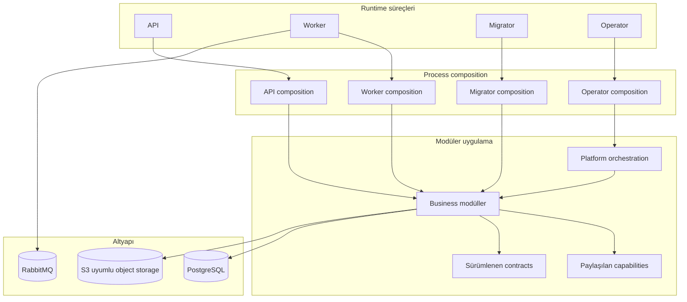

# Harpy

**Çok kiracılı (multi-tenant) ve kurum içi (on-premise) uygulamalar için Go tabanlı modüler backend platformu.**

Harpy; açık modül sahipliği, tenant izolasyonu, sözleşme odaklı arayüzler ve kalıcı arka plan işleme üzerine kurulu bir backend platformudur. Temel uygulama yeteneklerini ve bunları çalıştırmak için gereken altyapıyı tek bir Go codebase içinde bir araya getirir. Her yeteneği ayrı bir servise dönüştürmek yerine, modüler monolith yaklaşımıyla yönetilebilir sınırlar oluşturur.

**Harpy** ismi, güçlü ve dayanıklı bir backend vizyonunu temsil etmesi için harpy eagle'dan (harpi kartalı) esinlenerek seçildi.

<p align="center">
  <a href="https://go.dev/"></a>
  <a href="https://www.postgresql.org/"></a>
  <a href="https://www.rabbitmq.com/"></a>
  <a href="https://www.docker.com/"></a>
  <a href="https://opentelemetry.io/"></a>
</p>

---

## Genel Bakış

Harpy, yalnızca HTTP server ve database ihtiyacının ötesinde; identity, tenant yaşam döngüsü, authorization, ticari yetenekler, içerik yönetimi, iş birliği, analytics, notifications ve platform operasyonları gerektiren uygulamalar için geliştirilmiştir.

İki deployment modelini destekler:

| Model | Kullanım | Tenant yapısı |
| --- | --- | --- |
| **Single-tenant** | Müşteriye özel ortamlar ve on-premise kurulumlar | Tek müşteri ortamı |
| **Multi-tenant** | Paylaşımlı SaaS deployment'ları | Birbirinden izole birden fazla tenant |

Harpy bir **backend repository**'sidir. HTTP API sunar ve arka plan işlerini yürütür; bu repository içinde yerleşik bir frontend uygulaması bulunmaz.

## Yetenekler

Kod tabanı, açık veri ve iş kuralı sahipliğine sahip modüller etrafında düzenlenmiştir.

| Alan | Kapsam |
| --- | --- |
| **Identity & Access (IAM)** | Identity, authentication, credentials, sessions, organizations, RBAC, permissions, invitations, profiles ve service principals |
| **Tenancy** | Tenant yaşam döngüsü, provisioning, onboarding, deployment policy, tenant settings ve activation |
| **Billing** | Offerings, pricing, subscriptions, invoices, entitlements, usage, retention ve license authority |
| **Catalog** | İmzalı paketler, dependency resolution, release publication, component lifecycle ve menu yönetimi |
| **Work Management** | Boards, columns, memberships, tasks, labels, checklists, comments, calendars ve recurrence |
| **Documents** | Folders, items, versions, uploads, downloads, links, archives, recovery, encryption ve scanning entegrasyonları |
| **Notifications** | Messages, preferences, templates, provider configuration ve delivery |
| **Analytics** | Saved queries, query execution, dashboards, exports, publication ve access control |
| **Audit & Usage** | Owner operation audit kayıtları, field-change kanıtları, usage observations ve raporlama |
| **Platform Authority & Operations** | Authority kanıtları, diagnostics, health, alerts, traces, recovery sets ve restore operasyonları |
| **Support** | Platform ve tenant destek kayıtları ile bug reports |
| **System Resource Layout** | Sürümlenen system resource layout'ları ve presentation metadata |

Tablo, repository'de karşılığı bulunan yetenek alanlarını özetler; her olası ürün akışının tamamlandığı anlamına gelmez. Modüllerin ve paketlerin ayrıntılı envanteri için [modül paket haritasına](docs/architecture/15-modul-paket-haritasi.md) bakın.

## Mimari

Harpy, **modular monolith** mimarisini kullanır. Modüller business ownership sınırlarıdır; bağımsız deployable servisler değildir. Her modül kendi domain kurallarının, application use-case'lerinin ve persistence adapter'larının sahibidir. API, worker, migrator ve operator süreçleri ihtiyaç duydukları modülleri ayrı composition root'ları üzerinden bir araya getirir.

Bu yaklaşım, aynı process içindeki işlemlerde gereksiz network sınırları oluşturmadan kod ve veri sahipliğini açık tutar.

### Runtime süreçleri

| Süreç | Giriş noktası | Sorumluluk |
| --- | --- | --- |
| **API** | `core/cmd/api` | Public HTTP API, route assembly, request admission ve runtime readiness |
| **Worker** | `core/cmd/worker` | Background jobs, event consumers, retry ve asenkron yan etkiler |
| **Migrator** | `core/cmd/migrator` | Database migration yürütümü ve schema yaşam döngüsü |
| **Operator** | `core/cmd/operator` | Kurulum ve kontrollü platform operasyonları |
| **Setup CLI** | `cmd/setup` | Deployment profili yapılandırması ve yerel secret hazırlığı |

Process giriş noktaları ince tutulur. Dependency wiring ve runtime lifecycle yönetimi `core/internal/composition/` altındadır.

### Mimari sınırlar

- **Domain:** Business type'ları, invariant'ları ve state transition kurallarını barındırır; HTTP, database driver veya infrastructure SDK bağımlılığı taşımaz.
- **Application:** Use-case'leri, authorization çağrılarını, transaction sınırlarını ve side effect koordinasyonunu yönetir.
- **Ports & adapters:** Persistence, HTTP, event ve dış provider entegrasyonlarını izole eder.
- **Module API:** Modüller arası senkron iletişimin desteklenen arayüzüdür. Bir modül başka modülün private package'ine veya tablolarına erişmez.
- **Capabilities:** REST Query, object storage, artifact, credential delivery ve tenant activation gibi ortak teknik yetenekleri sunar.
- **Orchestration:** Birden fazla owner'ı kapsayan çok adımlı operasyonları koordine eder; business data sahipliğini devralmaz.
- **Composition roots:** Her process için somut modülleri ve adapter'ları birbirine bağlar.



### Veri sahipliği ve tenant izolasyonu

PostgreSQL; business data, kalıcı job state, idempotency receipt ve event publication intent için canonical state kaynağıdır.

Tenant verileri **schema-per-tenant** modeliyle ayrılır. Tenant scope, doğrulanmış actor context ve sunucu tarafında belirlenen canonical tenant identity üzerinden oluşturulur; request header'ından güvenilir kabul edilmez. Platform/global veriler ayrı sahiplik ve scope kurallarıyla yönetilir.

Modüller birbirlerinin tablolarını doğrudan sorgulamaz veya değiştirmez. Modüller arası işlemler owner API'leri, açık koordinasyon ve tanımlı transaction sınırları üzerinden yürütülür.

### Asenkron işleme

Harpy, PostgreSQL üzerinde kalıcı iş yönetimini RabbitMQ'yu integration transport olarak kullanmakla birleştirir.

- **Outbox**, event yayınlama niyetini business state değişikliğiyle aynı transaction içinde kaydeder.
- **RabbitMQ**, asenkron producer ve consumer'lar arasında event taşır; canonical state kaynağı değildir.
- **Database-backed jobs**, zamanlanmış ve arka plan işlerinin state, attempt, lease ve execution bilgilerini saklar.
- Consumer ve dış sistem etkileri retry ve at-least-once delivery koşulları dikkate alınarak; idempotency ve açık hata yönetimiyle tasarlanır.

### Contracts ve güvenlik

HTTP, event, runtime, authority, storage ve async processing sözleşmeleri `contracts/` altında sürümlenir. Request schema'ları, event versiyonları, producer/consumer policy'leri ve API tanımları açık arayüzler olarak yönetilir.

Güvenlik modeli **fail-closed** çalışır: doğrulanmış actor, tenant scope, permission veya authority kanıtı yoksa işlem varsayılan olarak kabul edilmez. Authentication ve authorization ayrı sorumluluklardır; resource seviyesindeki policy ilgili modülün sahibidir.

## Teknoloji Yığını

| Katman | Teknoloji |
| --- | --- |
| Dil | Go 1.26 |
| Relational database | PostgreSQL 18, pgx |
| Message broker | RabbitMQ 4 |
| Object storage | S3-compatible API; standart deployment profilinde RustFS |
| API contracts | Sürümlenen HTTP contracts, JSON Schema ve OpenAPI |
| Async contracts | Sürümlenen event, producer/consumer ve job manifestleri |
| Observability | OpenTelemetry traces ve metrics, OTLP exporters |
| Runtime | Docker Compose ve Task |
| Test | Go unit/application, adapter ve integration testleri; security ve architecture kontrolleri |

Dependency listesinin kaynağı [`go.mod`](go.mod), deployment servis tanımları ise [`deploy/third-party.yml`](deploy/third-party.yml) dosyasıdır.

## Hızlı Başlangıç

### Gereksinimler

Backend geliştirme için:

- Go 1.26 toolchain
- Docker Engine veya Docker Desktop ve Compose v2
- [Task](https://taskfile.dev/)
- İlk dependency ve image build işlemi için internet erişimi

Tam local stack, destek servislerinin yanında kardeş frontend projesini de başlatır. Ek gereksinimler ve operasyon detayları için [local development rehberine](ops/local/README.md) bakın.

### Tam local development stack'i başlatma

Tam yerel geliştirme ortamı için önerilen yol:

```bash
git clone https://github.com/Onurlulardan/harpy.git
cd harpy

task dev
```

`task dev`, repository'nin local stack akışını çalıştırır: makineye özel secret ve sertifikaları hazırlar, pinlenmiş image'ları build eder, altyapıyı başlatır, ortamı bootstrap eder, migration'ları uygular, runtime servislerini açar ve readiness kontrollerini yürütür.

Named volume verilerini koruyarak durdurmak için:

```bash
task stop
```

Logları izlemek için:

```bash
task local:logs
task local:logs:api
task local:logs:worker
```

> **Veri uyarısı:** `task local:destroy` yıkıcı bir işlemdir. Local database, broker, object storage ve ilişkili state'i siler. Yalnızca yerel ortamı sıfırlamak istediğinizde kullanın.

### Standart deployment profili hazırlama

Bağımsız single-tenant veya multi-tenant deployment için Setup CLI:

```bash
go run ./cmd/setup
```

Setup komutu seçilen profili doğrular, yerel configuration ve secret materyalini hazırlar, ilgili deployment ortam dosyasını yazar ve sonraki komutları ekrana basar.

İşlemi varsayılan cevaplarla, etkileşimsiz çalıştırabilirsiniz:

```bash
go run ./cmd/setup --defaults --profile single-tenant
# veya
go run ./cmd/setup --defaults --profile multi-tenant
```

Üretilen profil `deploy/<profile>/` altına yazılır. Setup CLI Docker başlatmaz ve tüm uygulama yaşam döngüsünü kendiliğinden yürütmez; Compose, migration, initialization, API ve worker için ekrana bastığı komutları izleyin.

Ayrıntılar: [Deployment ve operasyon](docs/architecture/09-deployment-ve-operasyon.md) ve [Local stack rehberi](ops/local/README.md).

## Geliştirme

### Repository yapısı

```text
cmd/
  setup/                       Deployment setup CLI

core/
  cmd/
    api/                       HTTP API giriş noktası
    worker/                    Background worker giriş noktası
    migrator/                  Database migration giriş noktası
    operator/                  Platform operator giriş noktası
  internal/
    composition/               Process bazlı runtime composition
    modules/                   Business modülleri ve sahiplik alanları
    capabilities/              Paylaşılan teknik yetenekler
    orchestration/             Çok adımlı platform iş akışları
    platform/                  Infrastructure ve runtime primitive'leri

contracts/                     Sürümlenen HTTP, event, runtime ve storage contracts
compat/                        Açıkça sınırlandırılmış uyumluluk adapter'ları
deploy/                        Single-tenant, multi-tenant ve ortak Compose tanımları
ops/                           Local geliştirme ve operasyon iş akışları
tools/                         Guard, contract ve mühendislik araçları
skills/                        Repository mühendislik prosedürleri
docs/
  architecture/                Mimari ve modül dokümantasyonu
```

### Kullanışlı komutlar

| Komut | Açıklama |
| --- | --- |
| `go test ./...` | Go test paketini çalıştırır |
| `go run ./tools/fileguard` | Dosya organizasyonu ve generated file provenance kurallarını denetler |
| `go run ./tools/archguard` | Package dependency ve mimari sınırları denetler |
| `task check` | Fileguard ve archguard kontrollerini çalıştırır |
| `task dev` | Tam local development stack'i başlatır |
| `task stop` | Local stack'i verileri koruyarak durdurur |

### Mühendislik kuralları

Repository çalışma protokolü [`AGENTS.md`](AGENTS.md) dosyasındadır. Kod değişikliğinden önce [`skills/INDEX.md`](skills/INDEX.md) üzerinden ilgili skill'i belirleyin; skill'i, etkilenen mimariyi ve contract dosyalarını inceleyin.

Temel kurallar:

1. Business state ve policy ilgili owner modülde kalır.
2. Senkron modüller arası iletişimde hedef modülün public API'si kullanılır.
3. Başka bir modülün tablolarına veya private package'lerine doğrudan erişilmez.
4. Handler transport sorumluluğunu taşır; business orchestration application use-case'lerinde bulunur.
5. Tenant identity doğrulanmış actor context'ten türetilir; eksik scope durumunda işlem reddedilir.
6. RabbitMQ state kaynağı değil, transport katmanıdır.
7. HTTP, event, runtime ve authority contract'ları açık ve sürümlü tutulur.
8. Yalnızca başarılı akışlar değil; authorization, tenant isolation, retry, idempotency ve hata senaryoları da test edilir.
9. Değişiklik tamamlanmadan önce hedefli testler ve ilgili kalite kontrolleri çalıştırılır.

## Dokümantasyon

Harpy'nin güncel mimarisini anlamak için [mimari dokümantasyon dizini](docs/architecture/README.md) başlangıç noktasıdır.

| Belge | Kapsam |
| --- | --- |
| [Genel bakış](docs/architecture/01-genel-bakis.md) | Ürün kapsamı, teknoloji, repository haritası ve süreçler |
| [Mimari ve modül sınırları](docs/architecture/02-mimari-ve-modul-sinirlari.md) | Modular monolith, katmanlar, bağımlılıklar ve sahiplik |
| [Runtime ve composition](docs/architecture/03-runtime-ve-composition.md) | Setup, API, worker, migrator, operator ve yaşam döngüsü |
| [Platform temelleri](docs/architecture/04-platform-temelleri.md) | Config, PostgreSQL, transaction, telemetry ve health |
| [HTTP API ve contracts](docs/architecture/05-http-api-ve-kontratlar.md) | Routing, HTTP contracts, hata modeli ve REST Query |
| [Veri ve tenant izolasyonu](docs/architecture/06-veri-ve-tenant-izolasyonu.md) | Schema-per-tenant, scope, data ownership ve transaction |
| [Event, job ve worker](docs/architecture/07-event-job-ve-worker.md) | Outbox, RabbitMQ, kalıcı job'lar, retry, lease ve worker |
| [Güvenlik modeli](docs/architecture/08-guvenlik-modeli.md) | Actor, IAM, RBAC, token, tenant güvenliği ve secrets |
| [Deployment ve operasyon](docs/architecture/09-deployment-ve-operasyon.md) | Compose profilleri, local stack, health ve operasyon |
| [Test ve mühendislik standartları](docs/architecture/10-test-ve-muhendislik-standartlari.md) | CI, test stratejisi, fileguard ve archguard |
| [Geliştirici rehberi](docs/architecture/11-gelistirici-rehberi.md) | Kurulum, komutlar, modül değişiklikleri ve troubleshooting |
| [Paylaşılan capabilities](docs/architecture/12-paylasilan-capabilities.md) | REST Query, artifact, tenant activation ve orchestration |
| [Contract kataloğu](docs/architecture/13-kontrat-katalogu.md) | HTTP, event, runtime, authority ve storage contracts |
| [Mimari kararlar](docs/architecture/14-mimari-kararlar.md) | Mimari trade-off'lar ve karar gerekçeleri |
| [Modül paket haritası](docs/architecture/15-modul-paket-haritasi.md) | Modüllere göre application ve adapter paketleri |

Modül bazlı belgeler: [IAM](docs/architecture/modules/iam.md), [Tenancy](docs/architecture/modules/tenancy.md), [Billing](docs/architecture/modules/billing.md), [Catalog](docs/architecture/modules/catalog.md), [Work](docs/architecture/modules/work.md), [Documents](docs/architecture/modules/documents.md), [Notifications](docs/architecture/modules/notifications.md), [Analytics](docs/architecture/modules/analytics.md) ve [diğer modüller](docs/architecture/modules/diger-moduller.md).

## Proje Kapsamı

Harpy'nin mevcut kapsamı, bu repository'de implement edilmiş backend altyapısı ve yetenekleridir. Proje genel amaçlı bir low-code platform veya bağımsız microservice koleksiyonu olarak konumlandırılmıyor. Forms Engine, Workflow Engine, AI modülü ve MCP server mevcut ürün kapsamına dahil değildir.

## Lisans

Repository'de şu anda bir lisans dosyası yayımlanmamıştır. Lisans eklenene kadar kodun yeniden kullanımı, değiştirilmesi veya dağıtılması için açık izin verildiği varsayılmamalıdır.
