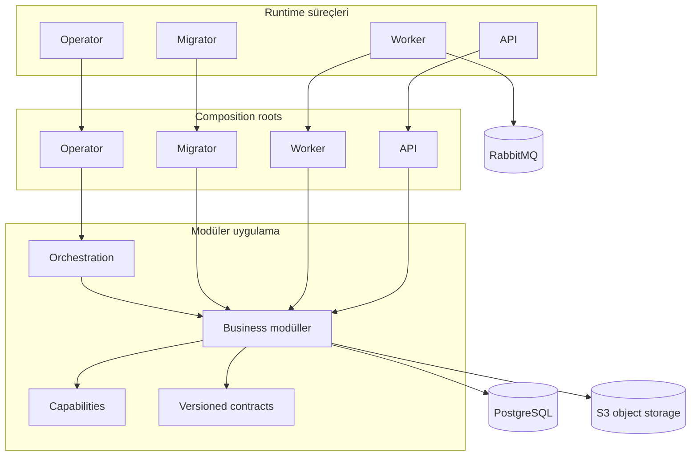

# Harpy

**Çok kiracılı (multi-tenant) ve kurum içi (on-premise) uygulamalar için Go tabanlı modüler backend platformu.**

Harpy; açık modül sahipliği, tenant izolasyonu, sözleşme odaklı arayüzler ve kalıcı arka plan işleme üzerine kurulu bir backend platformudur. Temel uygulama yeteneklerini ve çalışma altyapısını tek bir Go codebase içinde toplar. Her yeteneği ayrı bir servise dönüştürmek yerine modüler monolith yaklaşımıyla yönetilebilir sınırlar oluşturur.

**Harpy** ismi, güçlü ve dayanıklı bir backend vizyonunu temsil etmesi için harpy eagle'dan (harpi kartalı) esinlenerek seçildi.

<p align="center">
  <a href="https://go.dev/"></a>
  <a href="https://www.postgresql.org/"></a>
  <a href="https://www.rabbitmq.com/"></a>
  <a href="https://www.docker.com/"></a>
  <a href="https://opentelemetry.io/"></a>
</p>

---
## Genel Bakış
Harpy; identity, tenant yaşam döngüsü, authorization, ticari yetenekler, içerik yönetimi, iş birliği, analytics, notifications ve platform operasyonları gerektiren uygulamalar için geliştirilmiştir.

| Deployment modeli | Kullanım | Tenant yapısı |
| --- | --- | --- |
| **Single-tenant** | Müşteriye özel ortamlar ve on-premise kurulumlar | Tek müşteri ortamı |
| **Multi-tenant** | Paylaşımlı SaaS deployment'ları | Birbirinden izole birden fazla tenant |

Harpy bir **backend repository**'sidir. HTTP API sunar ve arka plan işlerini yürütür; bu repository içinde yerleşik bir frontend uygulaması bulunmaz.

## Yetenekler
Harpy'nin business yetenekleri açık veri ve iş kuralı sahipliğine sahip modüller halinde düzenlenmiştir:
- **IAM:** Identity, authentication, credentials, sessions, organizations, RBAC, permissions, invitations, profiles ve service principals.
- **Tenancy:** Tenant yaşam döngüsü, provisioning, onboarding, deployment policy, tenant settings ve activation.
- **Billing:** Offerings, pricing, subscriptions, invoices, entitlements, usage, retention ve license authority.
- **Catalog:** İmzalı paketler, dependency resolution, release publication, component lifecycle ve menu yönetimi.
- **Work Management:** Boards, columns, memberships, tasks, labels, checklists, comments, calendars ve recurrence.
- **Documents:** Folders, items, versions, uploads, downloads, links, archives, recovery, encryption ve scanning entegrasyonları.
- **Notifications / Analytics:** Mesaj, tercih, template, provider ve delivery yönetimi; saved queries, dashboards, exports, publication ve access control.
- **Audit & Usage:** Owner operation audit kayıtları, field-change kanıtları, usage observations ve raporlama.
- **Platform Authority & Operations:** Authority kanıtları, diagnostics, health, alerts, traces, recovery sets ve restore operasyonları.
- **Support / System Resource Layout:** Platform ve tenant destek kayıtları, bug reports, sürümlenen system resource layout'ları ve presentation metadata.

Bu liste repository'de karşılığı bulunan yetenek alanlarını özetler; her olası ürün akışının tamamlandığı anlamına gelmez. Ayrıntılı envanter için [modül paket haritasına](docs/architecture/15-modul-paket-haritasi.md) bakın.

## Mimari
Harpy, **modular monolith** mimarisini kullanır. Modüller business ownership sınırlarıdır; bağımsız deployable servisler değildir. Her modül kendi domain kurallarının, application use-case'lerinin ve persistence adapter'larının sahibidir. API, worker, migrator ve operator süreçleri ihtiyaç duydukları modülleri ayrı composition root'ları üzerinden bir araya getirir.

| Runtime süreci | Giriş noktası | Sorumluluk |
| --- | --- | --- |
| **API** | `core/cmd/api` | Public HTTP API, route assembly, request admission ve runtime readiness |
| **Worker** | `core/cmd/worker` | Background jobs, event consumers, retry ve asenkron yan etkiler |
| **Migrator** | `core/cmd/migrator` | Database migration yürütümü ve schema yaşam döngüsü |
| **Operator** | `core/cmd/operator` | Kurulum ve kontrollü platform operasyonları |
| **Setup CLI** | `cmd/setup` | Deployment profili yapılandırması ve yerel secret hazırlığı |

Process giriş noktaları ince tutulur. Dependency wiring ve runtime lifecycle yönetimi `core/internal/composition/` altındadır.

### Mimari sınırlar
- **Domain:** Business type'ları, invariant'ları ve state transition kuralları; HTTP, database driver veya infrastructure SDK bağımlılığı yoktur.
- **Application:** Use-case, authorization, transaction sınırı ve side effect koordinasyonu.
- **Ports & adapters:** Persistence, HTTP, event ve dış provider entegrasyonlarının izolasyonu.
- **Module API:** Modüller arası senkron iletişim arayüzü. Başka modülün private package'ine veya tablolarına doğrudan erişim yoktur.
- **Capabilities:** REST Query, object storage, artifact, credential delivery ve tenant activation gibi ortak teknik yetenekler.
- **Orchestration:** Birden fazla owner'ı kapsayan çok adımlı operasyonların koordinasyonu; business data sahipliğini devralmaz.
- **Composition roots:** Her process için somut modül ve adapter wiring'i.



### Veri sahipliği ve tenant izolasyonu
PostgreSQL; business data, kalıcı job state, idempotency receipt ve event publication intent için canonical state kaynağıdır. Tenant verileri **schema-per-tenant** modeliyle ayrılır. Tenant scope, doğrulanmış actor context ve sunucu tarafında belirlenen canonical tenant identity üzerinden oluşturulur; request header'ından güvenilir kabul edilmez. Platform/global veriler ayrı sahiplik ve scope kurallarıyla yönetilir. Modüller birbirlerinin tablolarına doğrudan erişmez; modüller arası işlemler owner API'leri ve tanımlı transaction sınırları üzerinden yürütülür.

### Asenkron işleme
- **Outbox**, event yayınlama niyetini business state değişikliğiyle aynı transaction içinde kaydeder.
- **RabbitMQ**, producer ve consumer'lar arasında event taşır; canonical state kaynağı değildir.
- **Database-backed jobs**, arka plan işlerinin state, attempt, lease ve execution bilgilerini saklar.
- Retry ve at-least-once delivery koşulları idempotency ve açık hata yönetimiyle ele alınır.

### Contracts ve güvenlik
HTTP, event, runtime, authority, storage ve async processing sözleşmeleri `contracts/` altında sürümlenir. Request schema'ları, event versiyonları ve producer/consumer policy'leri açık arayüzler olarak yönetilir. Güvenlik modeli **fail-closed** çalışır: doğrulanmış actor, tenant scope, permission veya authority kanıtı yoksa işlem kabul edilmez. Authentication ve authorization ayrı sorumluluklardır; resource seviyesindeki policy ilgili modülün sahibidir.

## Teknoloji Yığını
| Katman | Teknoloji |
| --- | --- |
| Dil | Go 1.26 |
| Relational database | PostgreSQL 18, pgx |
| Message broker | RabbitMQ 4 |
| Object storage | S3-compatible API; standart deployment profilinde RustFS |
| API contracts | Sürümlenen HTTP contracts, JSON Schema ve OpenAPI |
| Async contracts | Sürümlenen event, producer/consumer ve job manifestleri |
| Observability | OpenTelemetry traces ve metrics, OTLP exporters |
| Runtime | Docker Compose ve Task |
| Test | Go unit/application, adapter ve integration testleri; security ve architecture kontrolleri |

Dependency kaynağı [`go.mod`](go.mod), deployment servis tanımları [`deploy/third-party.yml`](deploy/third-party.yml) dosyasıdır.

## Hızlı Başlangıç
### Gereksinimler
Go 1.26 toolchain, Docker Engine veya Docker Desktop + Compose v2, [Task](https://taskfile.dev/) ve ilk dependency/image build işlemi için internet erişimi gerekir. Tam local stack, destek servislerinin yanında kardeş frontend projesini de başlatır; ayrıntılar için [local development rehberine](ops/local/README.md) bakın.

### Tam local development stack
```bash
git clone https://github.com/Onurlulardan/harpy.git
cd harpy
task dev
```
`task dev`, makineye özel secret ve sertifikaları hazırlar, pinlenmiş image'ları build eder, altyapıyı başlatır, ortamı bootstrap eder, migration'ları uygular, runtime servislerini açar ve readiness kontrollerini yürütür. Named volume verilerini koruyarak durdurmak için `task stop`; loglar için `task local:logs`, `task local:logs:api` veya `task local:logs:worker` kullanılır.

> **Veri uyarısı:** `task local:destroy` yıkıcıdır; local database, broker, object storage ve ilişkili state'i siler. Yalnızca ortamı sıfırlamak istediğinizde kullanın.

### Standart deployment profili
```bash
go run ./cmd/setup
# veya etkileşimsiz:
go run ./cmd/setup --defaults --profile single-tenant
go run ./cmd/setup --defaults --profile multi-tenant
```
Setup CLI profili doğrular, yerel configuration ve secret materyalini hazırlar, `deploy/<profile>/` altına ortam dosyasını yazar ve sonraki komutları gösterir. Docker başlatmaz veya tüm uygulama yaşam döngüsünü tek başına yürütmez; Compose, migration, initialization, API ve worker komutları için çıktıyı izleyin. Ayrıntılar: [Deployment ve operasyon](docs/architecture/09-deployment-ve-operasyon.md).

## Geliştirme
### Repository yapısı
```text
cmd/setup/                 Deployment setup CLI
core/cmd/                  API, worker, migrator, operator giriş noktaları
core/internal/composition/ Process bazlı runtime composition
core/internal/modules/     Business modülleri ve sahiplik alanları
core/internal/capabilities/Paylaşılan teknik yetenekler
core/internal/orchestration/Çok adımlı platform iş akışları
core/internal/platform/    Infrastructure ve runtime primitive'leri
contracts/                 Sürümlenen HTTP, event, runtime ve storage contracts
compat/                    Uyumluluk adapter'ları
deploy/                    Deployment ve Compose tanımları
ops/                       Local geliştirme ve operasyon iş akışları
tools/                     Guard, contract ve mühendislik araçları
skills/                    Repository mühendislik prosedürleri
docs/architecture/         Mimari ve modül dokümantasyonu
```

### Kullanışlı komutlar
| Komut | Açıklama |
| --- | --- |
| `go test ./...` | Go test paketini çalıştırır |
| `go run ./tools/fileguard` | Dosya organizasyonu ve generated file provenance kurallarını denetler |
| `go run ./tools/archguard` | Package dependency ve mimari sınırları denetler |
| `task check` | Fileguard ve archguard kontrollerini çalıştırır |
| `task dev` / `task stop` | Local stack'i başlatır / verileri koruyarak durdurur |

### Mühendislik kuralları
Repository çalışma protokolü [`AGENTS.md`](AGENTS.md) dosyasındadır. Kod değişikliğinden önce [`skills/INDEX.md`](skills/INDEX.md) üzerinden ilgili skill'i belirleyin; skill'i, etkilenen mimariyi ve contract dosyalarını inceleyin. Temel ilkeler: business state ve policy owner modülde kalır; modüller arası senkron iletişim public API ile yapılır; tenant identity doğrulanmış actor context'ten türetilir; RabbitMQ state kaynağı değil transport katmanıdır; contract'lar sürümlenir; authorization, tenant isolation, retry ve idempotency senaryoları test edilir.

## Dokümantasyon
Başlangıç noktası [mimari dokümantasyon dizinidir](docs/architecture/README.md).
- [Genel bakış](docs/architecture/01-genel-bakis.md) · [Mimari ve modül sınırları](docs/architecture/02-mimari-ve-modul-sinirlari.md) · [Runtime ve composition](docs/architecture/03-runtime-ve-composition.md)
- [Platform temelleri](docs/architecture/04-platform-temelleri.md) · [HTTP API ve contracts](docs/architecture/05-http-api-ve-kontratlar.md) · [Veri ve tenant izolasyonu](docs/architecture/06-veri-ve-tenant-izolasyonu.md)
- [Event, job ve worker](docs/architecture/07-event-job-ve-worker.md) · [Güvenlik modeli](docs/architecture/08-guvenlik-modeli.md) · [Deployment ve operasyon](docs/architecture/09-deployment-ve-operasyon.md)
- [Test ve mühendislik standartları](docs/architecture/10-test-ve-muhendislik-standartlari.md) · [Geliştirici rehberi](docs/architecture/11-gelistirici-rehberi.md) · [Paylaşılan capabilities](docs/architecture/12-paylasilan-capabilities.md)
- [Contract kataloğu](docs/architecture/13-kontrat-katalogu.md) · [Mimari kararlar](docs/architecture/14-mimari-kararlar.md) · [Modül paket haritası](docs/architecture/15-modul-paket-haritasi.md)

Modül dokümanları: [IAM](docs/architecture/modules/iam.md), [Tenancy](docs/architecture/modules/tenancy.md), [Billing](docs/architecture/modules/billing.md), [Catalog](docs/architecture/modules/catalog.md), [Work](docs/architecture/modules/work.md), [Documents](docs/architecture/modules/documents.md), [Notifications](docs/architecture/modules/notifications.md), [Analytics](docs/architecture/modules/analytics.md) ve [diğer modüller](docs/architecture/modules/diger-moduller.md).

## Proje Kapsamı ve Lisans
Harpy'nin mevcut kapsamı, bu repository'de implement edilmiş backend altyapısı ve yetenekleridir. Proje genel amaçlı bir low-code platform veya bağımsız microservice koleksiyonu değildir. Forms Engine, Workflow Engine, AI modülü ve MCP server mevcut ürün kapsamına dahil değildir.

Repository'de şu anda bir lisans dosyası yayımlanmamıştır. Lisans eklenene kadar kodun yeniden kullanımı, değiştirilmesi veya dağıtılması için açık izin verildiği varsayılmamalıdır.