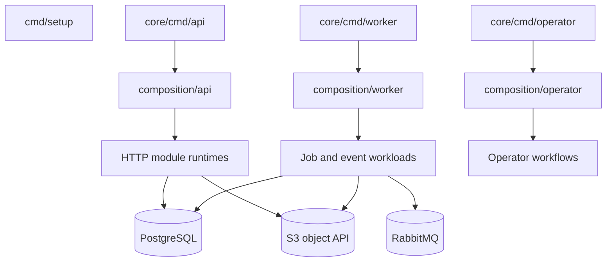

# 03 — Runtime ve composition

## 1. Süreç topolojisi

Harpy'nin çalışması setup aracıyla ortam dosyalarını oluşturmaktan, API ve worker süreçlerini başlatmaya uzanan bir akıştır. Uygulama process'leri modülleri doğrudan komut paketlerinden kurmaz; her süreç kendi composition root'unu çağırır.

## 2. Setup CLI

Kaynak: `cmd/setup/`.

`go run ./cmd/setup` interaktif profil hazırlığını başlatır. `--defaults` varsayılan cevapları kullanır; `--profile single-tenant|multi-tenant` profil seçimini açıkça belirtir. Setup:
1. Repository kökünü `go.mod` üzerinden bulur.
2. Argümanları ve profil adını doğrular.
3. Önceki profil ayarlarını okur.
4. Secret değerlerini hazırlar ve gerekli admin credential'ını üretir/korur.
5. Cevapları validate eder.
6. İlgili `deploy/<profile>` altına env ve secret dosyalarını yazar.
7. Sonraki compose ve process komutlarını ekrana basar.

Setup'ın sorumluluğu ortam hazırlığıdır; API route veya business use-case yürütmez.

## 3. API process

Giriş: `core/cmd/api/main.go` → `core/internal/composition/api.Run`.

API composition başlıca şu işleri yapar:
- Typed API/runtime config'i yükler.
- PostgreSQL pool'u API runtime profiliyle açar.
- Deployment policy ve readiness monitor'ünü kurar.
- Telemetry/logger runtime'ını bağlar.
- IAM authentication/security runtime'ını hazırlar.
- Modül HTTP runtime'larını kurar.
- Public route registry ve management handler'ını üretir.
- API ve management HTTP server'larını başlatır.
- Readiness için modül runtime'larının hazır olmasını şart koşar.

Route grupları IAM, billing, documents, notifications, Work, Analytics, Audit, Platform Ops, Support, Usage, deployment/customer ve system resource layout alanlarından gelir. Kesin endpoint kaynağı `contracts/http/` ve modül HTTP adapter'larıdır.

## 4. Public ve management yüzeyleri

API iki ayrı HTTP sunucusu oluşturur:
- **Public server:** İstemci istekleri, route registry ve edge admission/security katmanı.
- **Management server:** Health/readiness, servis bilgisi ve operasyonel gözlem uçları.

`build_api_servers.go` public handler'ı `httpedge.NewHandler` ile kurar ve public actor assertion girişini ayrıca reddeder. Management handler ayrı oluşturulur. Public surface ile management surface aynı güvenlik varsayımlarını paylaşmaz.

JWKS public route'u `/.well-known/jwks.json` adresinde GET ve HEAD metotlarıyla kayıt edilir.

## 5. Readiness bileşenleri

API readiness bileşik bir koşuldur. Kaynakta açıkça kontrol edilen runtime alanları:
- IAM actor bridge
- Analytics HTTP runtime
- Documents HTTP handler
- Notifications HTTP runtime
- Work HTTP runtime
- Secondary HTTP runtime grubu
- System resource layout HTTP runtime

Bir modül hazır değilse API composition readiness'i başarılı saymaz. Bu, route listesi oluşturulmuş olmasının tek başına servisin hazır olduğu anlamına gelmediğini gösterir.

## 6. Worker process

Giriş: `core/cmd/worker/main.go` → `composition/worker.Run`.

Worker startup sırası:
1. Worker typed config ve build bilgisini alır.
2. PostgreSQL worker profilinde açılır ve startup preflight yürütülür.
3. Deployment policy bağlanır.
4. İlk readiness probe çalıştırılır.
5. Worker admission gate açılır.
6. Async workload, IAM resources, processor registry ve observability runtime'ı kurulur.
7. Management server ve health poller hazırlanır.
8. Workload'lar supervisor üzerinden başlatılır.

Worker; DB job processor'ları, outbox publisher, RabbitMQ event consumer, retention ve modül bazlı processor'ları yönetir.

## 7. Operator process

Giriş: `core/cmd/operator/main.go` → `composition/operator.Run`.

Operator uzun yaşayan API route sunucusu olarak tasarlanmamıştır. Kurulum veya belirli yönetim işlemleri için composition/operator altındaki dar, one-shot process flow'larını bir araya getirir. Operator composition; environment authority, installation delivery, billing/platform finalization ve identity/license gibi owner akışlarını uygun adapter'larla bağlar.

## 8. Lifecycle ve hata davranışı

Runtime süreçlerinde startup, readiness, admission, graceful drain ve shutdown birbirinden ayrılır:
- Startup dependency preflight başarısızsa runtime trafik/iş kabulüne geçmez.
- API request lifecycle'ı ve worker execution lifecycle'ı ayrı yönetilir.
- Worker async supervisor workload başlatma, drain, wait, force ve failure izlemeyi kapsar.
- Shutdown sırasında önce yeni iş kabulünü durdurmak, sonra aktif işi drain etmek hedeflenir.
- Telemetry provider ve DB pool gibi kaynaklar kapatılır.

## 9. Composition kuralları

Composition constructor wiring yapar; business decision veya domain state transition sahibi değildir. API process modülü doğrudan komut paketinden import etmez. Örnek: `build_work_http.go` IAM erişimini, transaction coordinator'ı ve Work runtime kaynaklarını birleştirir; HTTP handler modülün kendi constructor'ıyla oluşturulur.

## 10. Kaynak kod haritası

| Akış | Kaynak |
| --- | --- |
| API entrypoint | `core/cmd/api/main.go` |
| API runtime | `core/internal/composition/api/` |
| Public routes | `build_public_routes.go` |
| API servers | `build_api_servers.go` |
| API readiness | `build_api_readiness.go` |
| Worker entrypoint | `core/cmd/worker/main.go` |
| Worker runtime | `core/internal/composition/worker/` |
| Async workload | `build_async_workload.go` |
| Async supervision | `async_supervisor.go` |
| Operator entrypoint | `core/cmd/operator/main.go` |
| Operator runtime | `core/internal/composition/operator/` |
| Setup CLI | `cmd/setup/` |
