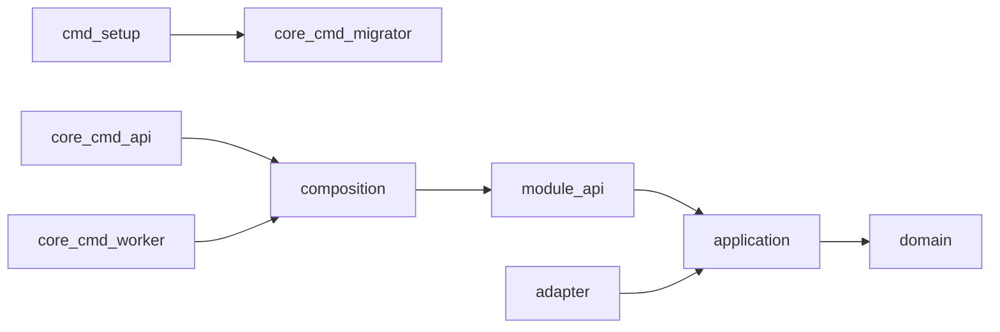

# Mimari

Ok, bağımlılık yönüdür. Sınırın tamamı [modular-architecture](../../skills/modular-architecture/SKILL.md) skill'indedir. Import ölçümü [fileguard ve archguard](03-fileguard-archguard.md) sayfasındadır.



`core/cmd/api` yalnız `core/internal/composition/api` paketini import eder. `core/cmd/worker` yalnız `core/internal/composition/worker` paketini import eder. `core/cmd/migrator` girişi `core/internal/composition/migrator`, operator girişi `core/internal/composition/operator` paketidir.

`cmd/setup`, migrator paketini import etmez. `setup --> migrator` oku, setup'ın bastığı komut sırasıdır.

Composition, modülü kurar. Örnek: `core/internal/composition/api/build_work_http.go`, `core/internal/modules/work` paketini import eder. `core/cmd/api` bu paketi import etmez.

`api` application'ı çağırır. Application domain'e iner. Adapter application'ın yanındadır. Postgres, HTTP ve event adapter'ı application portuna bağlanır.

```text
adapter -> application -> domain
```

Platform `core/internal/platform` altındadır. Config, clock, postgres, transaction, telemetry, HTTP transport ve blob adapter gibi teknik primitifler oradadır. Platform modül import etmez. İş modelinin yeri skill'de yazılıdır.

Başka modülün iç paketi yerine o modülün `api` paketi import edilir. `work` HTTP'si IAM'e giderse hedef `core/internal/modules/iam/api` olur.
