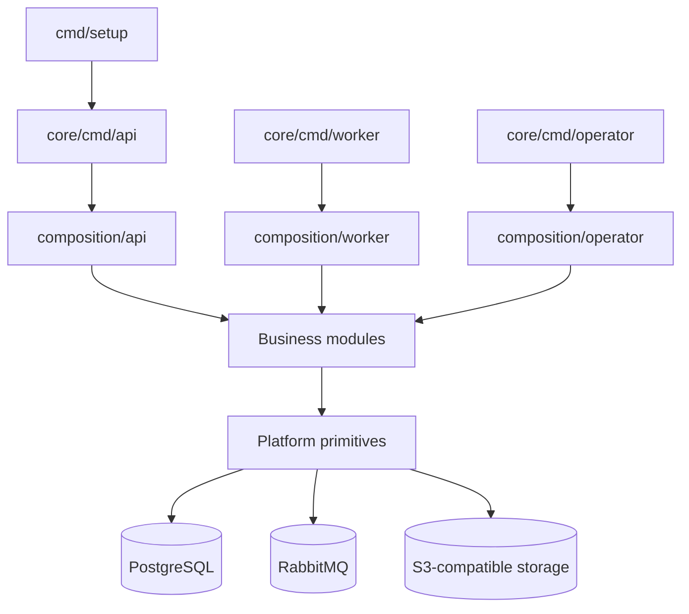

# Harpy — Teknik Mimari ve Geliştirici Rehberi

> Repository kaynak kodu ve mevcut teknik dokümanları esas alır. Harpy bu depoda Go tabanlı bir backend starter'dır; frontend uygulaması bu repository'nin kapsamında değildir.

## 1. Kapsam ve teknoloji

Harpy; IAM, tenant yönetimi, iş kuyruğu, worker, platform operasyonları ve iş modüllerini bir araya getiren modüler bir backend altyapısıdır. Single-tenant (on-premise) ve multi-tenant (SaaS) profilleri bulunur.

- Go module: `github.com/Onurlulardan/harpy`; Go `1.26.0`, toolchain `1.26.5`.
- Kalıcı veri: PostgreSQL.
- Asenkron mesaj taşıma: RabbitMQ.
- Blob saklama: S3 uyumlu API, AWS SDK for Go v2.
- Yerel object storage: RustFS.

## 2. Sistem mimarisi

Harpy modüler monolit yaklaşımını kullanır. İş modülleri aynı backend process'lerinde çalışabilir; modül sınırları paket/API ve veri sahipliğiyle korunur. API, worker ve operator ayrı giriş noktalarıdır. Composition katmanı her sürecin modüllerini ve adapter'larını kurar.



| Giriş noktası | Sorumluluk |
| --- | --- |
| `cmd/setup` | Profil ve yerel ortam dosyalarını hazırlar, sonraki komutları gösterir. |
| `core/cmd/api` | HTTP API sürecini başlatır; API composition paketini çağırır. |
| `core/cmd/worker` | Arka plan işlerini çalıştırır; worker composition paketini çağırır. |
| `core/cmd/operator` | Kurulum/yönetim görevlerini yürütür; operator composition paketini çağırır. |

Composition root, somut modül implementasyonlarını ve teknik adapter'ları bir araya getirir. Komut giriş noktaları modülleri doğrudan kurmaz.

## 3. Paket sınırları ve katmanlar

İş modülleri `core/internal/modules/<module>` altındadır. Modülün ihtiyacına göre kullanılan yapı:

```text
<module>/
  api/                 # Modüller arası kontrat (gerekiyorsa)
  domain/              # İş kavramları ve kuralları
  application/         # Use-case ve transaction koordinasyonu
  ports/               # Modüle özel arayüzler
  adapters/http/
  adapters/postgres/
  adapters/events/
  module.go            # Constructor/kurulum yüzeyi
```

Bağımlılık yönü: adapter → application → domain; composition → module constructor; modül A → modül B'nin `api` paketi.

- Başka modülün `api` dışındaki iç paketleri import edilmez.
- Modüller birbirlerinin tablolarına doğrudan SQL/JOIN veya ORM ilişkisiyle erişmez.
- Domain HTTP, SQL sürücüsü veya bulut SDK'sı gibi altyapı tiplerine bağlanmaz.
- Application framework veya transport implementasyonuna bağlanmaz.
- Platform yalnız teknik primitive sağlar; business modüllerini import etmez.
- Aynı process içindeki modüller senkron iletişimde owner modülün API'sini çağırır.

## 4. Modül kataloğu

Modüller `core/internal/modules` altında bulunur:

| Modül | Sorumluluk |
| --- | --- |
| `iam` | Kimlik, oturum, aktör ve erişim kontrolü |
| `tenancy` | Tenant yaşam döngüsü ve tenant kapsamı |
| `billing` | Lisans, abonelik, ödeme, entitlement ve kullanım politikaları |
| `catalog` | Paket/katalog ve katalog bileşenleri |
| `work` | Board, task, collaboration ve takvim |
| `documents` | Belge ve dosya işlemleri |
| `notifications` | Bildirim ve tüketici akışları |
| `analytics` | Analitik sorgular, dashboard ve yayınlama |
| `audit` | Denetim kayıtları |
| `usage` | Kullanım ölçümü |
| `platformauthority` | Platform yetki/otorite kayıtları |
| `platformops` | Platform operasyonları |
| `support` | Destek işlevleri |
| `system_resource_layout` | Sistem kaynak yerleşimi |

Bu tablo yüksek seviyeli bir rehberdir; kesin use-case sahipliği ilgili modülün source kodundadır.

## 5. Veri ve entegrasyonlar

PostgreSQL kalıcı iş verisinin ana deposudur. Repository/adapter kodu modülün kendi veri sınırında kalır. Modüller arası paylaşım owner API'si veya tanımlı event kontratlarıyla yapılır.

`contracts/` sürümlü süreç ve modül kontratlarını içerir:
- `contracts/http/`: HTTP/OpenAPI şema ve path tanımları.
- `contracts/events/`: event envelope, producer/consumer policy ve event şemaları.
- `contracts/authority/`: yetki alanlarına ait deklaratif tanımlar.
- `contracts/runtime/`: runtime konfigürasyonu, health ve hata sözleşmeleri.
- `contracts/storage/`: veri sahipliği ve storage sınırları.

RabbitMQ asenkron taşıma katmanıdır; iş verisinin doğruluk kaynağı değildir. Mesajların güvenilir işlenmesi event/job kontratları ve worker consumer politikalarıyla birlikte ele alınır.

Blob işlemleri S3 uyumlu arayüz arkasındadır. Yerel RustFS veya harici S3 servisi aynı AWS SDK istemci yüzeyi üzerinden yapılandırılır.

## 6. Kimlik, yetkilendirme ve tenant güvenliği

IAM ve tenancy ayrı modül sahiplikleridir. Kimlik doğrulama ile isteğin tenant ve yetki kapsamı ayrı kararlardır.

- Tenant kimliği doğrulanmış actor context üzerinden belirlenir; istemci header'ı tek başına güvenilir kaynak değildir.
- Authorization kararı handler veya repository içine gömülmez; application/use-case sınırında uygulanır.
- Modüller arası erişim hedef modülün public API'si üzerinden yürür.
- Yetki veya kapsam doğrulanamadığında davranış fail-closed olmalıdır.
- Secret/anahtar materyali kaynak koda konulmaz; yerel secret yolları ignore kurallarıyla korunur.

Kesin endpoint ve permission kataloğu IAM kontratları ve implementasyonlarından okunmalıdır.

## 7. HTTP API ve hata modeli

HTTP composition, modül HTTP adapter'larını bir araya getirir. Handler HTTP girdisini çözer, application use-case'ini çağırır ve sonucu HTTP cevabına dönüştürür. İş kuralı handler'a, authorization kararı repository'ye taşınmamalıdır.

HTTP kontratlarının kaynağı `contracts/http/` şema/path dosyaları ve bunları kullanan adapter'lardır. Hata cevapları runtime error-envelope kontratlarıyla tanımlanır. API değişikliklerinde kontrat, adapter ve contract testleri birlikte değerlendirilmelidir.

## 8. Runtime ve yerel geliştirme

Kurulum aracı `go run ./cmd/setup` ile başlatılır. Profil single-tenant veya multi-tenant seçilir; kurulum env/secret dosyalarını yazar ve sonraki komutları gösterir. Setup servisleri arka planda başlatmaz.

Yerel geliştirme komutu:

```bash
task dev
```

Altyapı servisleri compose tanımlarında yönetilir. Profil ve servis konfigürasyonu için `deploy/`, yerel görevler için `.taskfiles/` ve `ops/local/` incelenmelidir.

| Bileşen | Rol |
| --- | --- |
| API | Dış HTTP istekleri |
| Worker | Asenkron iş tüketimi |
| Operator | Kurulum ve yönetim görevleri |
| PostgreSQL | Kalıcı veri |
| RabbitMQ | Asenkron mesaj taşıma |
| S3 uyumlu storage | Blob ve artifact içeriği |

## 9. Sağlık, operasyon ve gözlemlenebilirlik

Runtime kontratlarında `livez` ve `readyz` uçlarına ilişkin şema ve testler bulunur. Compose servisleri readiness endpoint'ini healthcheck ile kontrol eder. Telemetry ve health implementasyonları `core/internal/platform` altında aranmalıdır.

Operasyonel inceleme: container health → readiness endpoint → servis logları → PostgreSQL/RabbitMQ/object storage health → API, worker veya operator kaynak ayrımı.

## 10. Test ve kalite kapıları

CI tanımı `.github/workflows/ci.yml` içindedir. Push ve pull request olaylarında Go testleri, generated artifact doğrulamaları, `tools/fileguard` ve `tools/archguard` çalıştırılır.

Elle yazılan dosyalarda en fazla 200 fiziksel satır, tek sorumluluk, niyet belirten dosya adları, ayrıştırılmış use-case'ler ve katman bağımlılıklarının korunması beklenir. Generated dosyalar elle düzenlenmez.

Yerel kalite komutları:

```bash
go test ./...
go run ./tools/fileguard
go run ./tools/archguard
```

## 11. Yeni geliştirici okuma sırası

1. [README](../../README.md) — repository amacı ve ilk komut.
2. [AGENTS çalışma protokolü](../../AGENTS.md) — değişiklik öncesi kurallar.
3. [Harpy nedir](00-nedir.md) — kapsam ve süreçler.
4. [Mimari](01-mimari.md) — katmanlar ve bağımlılık yönü.
5. [Yeni modül](02-yeni-modul.md) — modül sınırları.
6. [fileguard ve archguard](03-fileguard-archguard.md) — otomatik kontroller.
7. İlgili modülün `SKILL.md`, source kodu, kontratları ve hedefli testleri.

## 12. Mimari karar özeti

| Karar | Gerekçe |
| --- | --- |
| Modüler monolit | İş yeteneklerini kod/veri sahipliğiyle ayırırken dağıtık sistem karmaşıklığını sınırlamak. |
| Composition root | Süreç bağımlılıklarını tek yerde kurmak. |
| Owner modül API'si | İç implementasyon ve veri erişimini modül sınırında tutmak. |
| PostgreSQL | İş verisi için kalıcı depolama. |
| RabbitMQ | Asenkron işleri HTTP request yaşam döngüsünden ayırmak. |
| S3 uyumlu blob API | Yerel ve harici object storage'ı aynı istemci yüzeyinde tutmak. |
| Fileguard/archguard | Dosya organizasyonu ve bağımlılık kurallarını CI'da doğrulamak. |

## Doğruluk notu

Bu belge mevcut backend yapısını açıklar; kaynak kodunda bulunmayan frontend veya istemci mimarisi varsaymaz. Modül sorumlulukları yüksek seviyede özetlenmiştir. Kesin davranış ve güvenlik kararları için ilgili modülün source kodu, testleri ve `contracts/` tanımları esas alınmalıdır.
